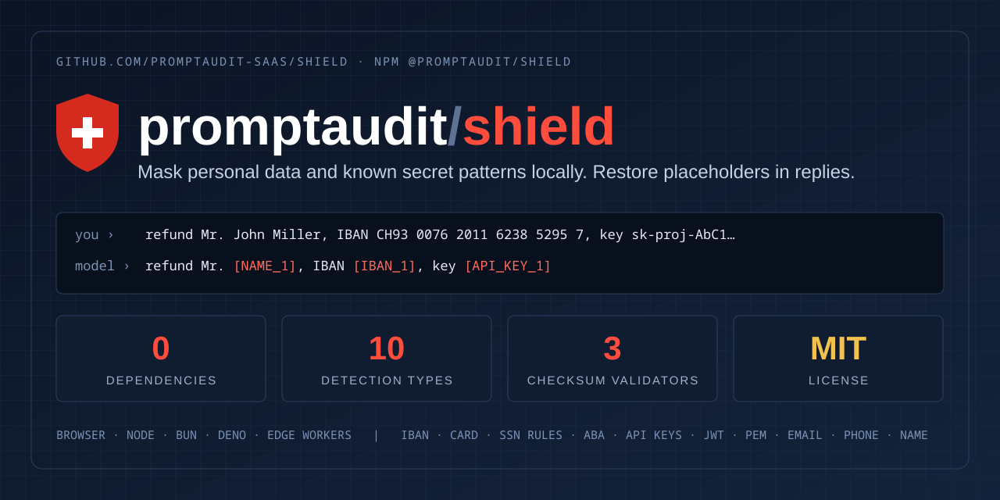

# @promptaudit/shield



**Mask personal data and known secret patterns locally. Restore placeholders in responses, including across text chunks.**

MIT · TypeScript · zero runtime dependencies · no network calls or telemetry in the package

```bash
npm install @promptaudit/shield
```

```ts
import { shieldMessages } from '@promptaudit/shield';

const session = shieldMessages([
  { role: 'user', content: 'Contact: fictional@example.invalid' },
]);
console.log(session.messages); // content: 'Contact: [EMAIL_1]'
console.log(session.restore('Reply for [EMAIL_1]')); // local original
session.clear();
```

The data is fictional. An empty match list does not prove that text contains no secrets.

## Data flow and trust boundary

```text
Your process / browser
  Original text -> shield / shieldMessages -> masked text
                       |
                  Mapping in RAM
                       |
  Local restoration <- model response containing placeholders
```

The package sends nothing itself. **Your code decides** what reaches a model and who receives restored originals. `restore`, `unshield` and streaming helpers return plaintext to their caller. A compromised process or incorrect call can expose originals.

## Text and chat messages

| Function | Result |
| --- | --- |
| `shield(text, detectorsOrOptions?)` | `{ masked, map, counts }`, existing single-text API |
| `unshield(text, map)` | Local restoration of known placeholders |
| `withShield(prompt, call)` | Mask → caller's own request → restore locally |
| `shieldMessages(messages, detectorsOrOptions?)` | New messages, shared category counts, `restore`, `createRestoreStream`, `clear` |
| `createUnshieldStream(map, options?)` | Web Streams pair for text chunks |
| `createUnshieldSseStream(map, options)` | Bounded Web Streams pair for explicitly selected OpenAI/Anthropic SSE formats |

`shieldMessages` copies messages and text blocks without mutating input and uses a separate mapping per call. The same detected string gets the same placeholder within that call; existing input placeholders are reserved. `counts` counts unique detected values, not every occurrence.

Supported: `content: string`, `content: null` and plain `{ type: 'text', text: string }` blocks. **Images, files, tool calls and tool results are rejected**, not silently forwarded as protected. Metadata such as `name` is copied unchanged and is not masked. Anthropic system text outside `messages` and Gemini `contents` are not covered by this function. Vercel UI messages using `parts` instead of `content` require explicit conversion.

## Custom terms and structured values

```ts
import { shieldMessages, shieldToolCalls } from '@promptaudit/shield';
const session = shieldMessages([{ role: 'user', content: 'Project Alpha' }], {
  customTerms: ['Project Alpha'],
}); // content: [TERM_1]
session.clear();
const tools = shieldToolCalls([{ type: 'function', id: 'fictional', function: {
  name: 'lookup', arguments: '{"client":"Project Alpha","limit":10}',
} }], { customTerms: ['Project Alpha'] });
// tools.data contains masked string values; IDs, names and numbers are preserved.
tools.clear();
```

`shieldStructured(value, options)` returns `{ data, counts, restore, clear }` for explicitly supplied plain JSON data. Objects and arrays are copied; class type/reference identity is not promised. Keys remain **unmasked** and may themselves contain sensitive information. Do not forward such keys without reviewing them.

`shieldToolCalls` supports OpenAI `type: function` with serialized `arguments` and Anthropic `type: tool_use` with `input`. Valid serialized JSON is changed only within string-value spans: whitespace, keys, duplicate keys and number lexemes are preserved. **Invalid JSON, cycles, getters, classes and exceeded limits are rejected**, never forwarded unchecked. Masked string values may still violate a tool's enum/format constraints; validate against its schema separately before execution and establish an explicit local restoration boundary. Provider wrappers do not automatically restore or execute model-generated tool commands.

Terms: Aho–Corasick; earliest/longest non-overlapping match; Unicode boundaries including combining marks. Case-insensitive matching uses simple per-code-point folding, **not full language-specific normalization** (for example ß/ss or contextual sigma). `caseInsensitive: false` and `wholeWords: false` are explicit options. Engine normalization still applies.

Limits: 1,000 terms; 256 UTF-16 code units per term; 1,048,576 units per text/session reservation; 100,000 candidates; 10,000 placeholders; structured data defaults to depth 64 and 50,000 nodes. Work also depends on dictionary size and match count; no O(1)-memory or zero-latency promise. Arbitrary caller-supplied regex detectors are not protected against ReDoS by the term matcher.

## Provider wrappers: an explicitly bounded interface

```ts
import { wrapOpenAI } from '@promptaudit/shield';
// originalClient: your separately installed SDK client with your own key.
const client = wrapOpenAI(originalClient, { customTerms: ['Project Alpha'] });
const stream = await client.chat.completions.create({
  model: configuredModel, messages: [{ role: 'user', content: 'Project Alpha' }], stream: true,
});
try {
  for await (const chunk of stream) {
    const localText = chunk.choices[0]?.delta.content ?? '';
    // localText may contain originals: share only with authorised recipients.
  }
} finally { stream.abort(); }
```

`wrapAnthropic(originalClient).messages.create(...)` returns a normal Promise; `await client.messages.stream(...)` returns a custom, single-consumption AsyncIterable with `abort()`. System text and supported text/tool payloads are masked before the delegated SDK call. Text responses are restored locally. Request options and AbortSignal are forwarded to the caller's SDK; that SDK, not Shield itself, opens the connection.

**Not a complete SDK drop-in:** No OpenAI Responses/Realtime/Batch API, `.withResponse()`, `.asResponse()`, `.tee()` or Anthropic event listeners/`.finalMessage()`/`.finalText()`. Here Anthropic `.stream()` is asynchronous, not a native SDK MessageStream. Images and unknown content blocks are rejected. OpenAI `role: tool` results are accepted only as valid serialized JSON in this facade; Anthropic `tool_result` only as a string. Other formats need their own reviewed adapter. Tool schemas, IDs, names and other metadata remain unmasked; only explicitly supported text and argument fields are protected. The original client remains accessible separately; its calls bypass the wrapper.

Mappings and text channels are isolated per request. Completion, errors and early loop termination clean up and abort that provider request. Unconsumed streams expire after five minutes by default (`timeoutMs`, maximum 30 minutes); call `stream.abort()` explicitly for earlier release. RAM retention is not secure memory erasure. Buffered text is emitted before channel completion; failed streams are not represented as complete. Restoration using the same session is no longer possible after stream completion.

Compatibility tests use the actually installed SDKs **OpenAI 7.65.0 and Anthropic 1.14.0** with local fetch responses. This checks their serialization/streaming, **not real model calls, model behaviour or every SDK version**. The SDKs are development dependencies only and are not bundled into the runtime package.

## Example: OpenAI chat with your own SDK

```ts
import { shieldMessages } from '@promptaudit/shield';
// client is your separately installed and configured OpenAI client.
const session = shieldMessages([{ role: 'user' as const, content: 'Email fictional@example.invalid' }]);
try {
  const response = await client.chat.completions.create({
    model: configuredModel, messages: session.messages,
  });
  const localAnswer = session.restore(response.choices[0]?.message.content ?? '');
  // localAnswer contains originals again. Review recipients before sharing.
} finally {
  session.clear();
}
```

This is an integration pattern, not an executed external model call. The developer selects the SDK and model. Other providers require review of their specific message types before integration.

## Text streaming

A placeholder may arrive across chunks: `[` → `IB` → `AN_1]`. Restoration checks **exact keys in the local mapping**, not just category names. Unknown tokens, Markdown brackets and incomplete tokens remain unchanged. Backpressure is passed through native Web Streams.

```ts
import { createUnshieldStream, shield } from '@promptaudit/shield';
const session = shield('Email fictional@example.invalid');
// textStream: ReadableStream<string> of model text, not raw SSE/JSON.
const restored = textStream.pipeThrough(createUnshieldStream(session.map));
```

For Vercel AI SDK, this pattern is limited to a real `ReadableStream<string>` such as `result.textStream`. It is **not** a general replacement for that SDK's UI/tool stream protocol.

The helpers return a `ReadableWritablePair` wrapping a native `TransformStream` instance with abort cleanup. No additional parser is required. `Transformer.cancel` is not assumed to be portable.

### Resources and cancellation

- Default `maxBufferSize: 256` **UTF-16 code units**, not bytes. Range 8–4,096; all mapping keys must fit, otherwise an error is raised before starting.
- The pending token buffer is bounded. The prefix set grows with the number and length of known keys; the whole session is **not O(1)**.
- Reader cancellation, writer abort, errors and normal completion clear the internal parser. An optional `signal` abort stops processing.
- `clearVaultOnTerminate: true` clears the map only under exclusive ownership. With `shieldMessages`, call `session.clear()` after all streams finish; one stream must not clear a shared session.
- Clearing a map is **not secure RAM zeroing**; JavaScript cannot guarantee erasure of existing strings and external copies. Never share mappings globally across users or log them.

## Raw SSE

```ts
import { shield, createUnshieldSseStream } from '@promptaudit/shield';
const session = shield('Email fictional@example.invalid');
// body: ReadableStream<Uint8Array> from your own provider request.
const restoredBody = body.pipeThrough(createUnshieldSseStream(session.map, {
  provider: 'openai', // or 'anthropic'; select explicitly
  clearVaultOnTerminate: true,
}));
```

Local fixtures cover OpenAI Chat Completions (`choices[index].delta.content`) and Anthropic text deltas (`content_block_delta`, `index`, `delta.type: text_delta`). No claim of compatibility with all SDK versions or Gemini/OpenAI Responses/Vercel UI protocols.

The parser preserves SSE comments, `event`, `id`, `retry`, multiline `data` fields and non-text events; line endings are normalized to LF. Output channels have separate token buffers. Incomplete text is emitted before an end event; this may create an extra text delta using the last known envelope. Do not use it for signed events or events that must remain byte-identical.

Default limits: **65,536 UTF-16 code units per event, 32 active text channels**; configurable up to 1,048,576 and 128 respectively. Invalid UTF-8, malformed JSON and exceeded limits produce an error rather than silent text loss. Metadata and non-text payloads are not masked. No fetch interception or automatic prompt interception.

## Detection and limits

IBAN (Mod-97); cards (Luhn plus supported prefixes); US SSN structural rules; ABA routing checksum with a keyword; email; international phone numbers; names following supported English titles; known API-key patterns/JWT; PEM private keys; credential-bearing database URLs; `.env` secret patterns; Bearer values.

- US SSN rules are structural checks, **not a checksum or identity verification**.
- No built-in entropy check. `.env` matches are pattern recognition, not proof of real credentials.
- Free-form addresses, names without a supported title, medical terms and unknown secret formats may remain undetected. False positives are possible, even with valid checksums.
- Normalization removes zero-width characters and folds full-width characters; restoration returns normalized matched values, **not byte-identical originals**.
- No NER models, independent certification, DLP guarantee, encrypted storage or audit logs. NLP systems address different detection tasks; no Presidio speed/size comparison has been measured here.

## Reproducible local checks

From the source repository with Bun:

```bash
bun test src
bun run typecheck
bun run build
bun run bench
```

The benchmark uses fictional data and reports corpus length, 1,000 measurements, median/p95 and unminified ESM/gzip sizes. Results apply to the device and runtime used; **no fixed <5 KB, 0 ms or sub-millisecond promises**.

References: [Web Streams](https://streams.spec.whatwg.org/), [SSE](https://html.spec.whatwg.org/multipage/server-sent-events.html).

## Contributing and related tools

Fictional counterexamples and reproducible regression tests are welcome. Do not include real keys or personal data in issues or pull requests. Review API compatibility, abort paths and package contents before publishing.

The separate [MCP adapter](https://github.com/PromptAudit-SaaS/mcp) uses the local engine. Its tools are `mask_text`, `scan_text`, `restore_text`, `mask_json` and `restore_json`; it does not automatically intercept arbitrary client input. The adapter can scan a Git diff explicitly piped into its CLI. An automatic pre-commit hook and SARIF are **not implemented** here.

[PromptAudit](https://promptaudit.ch) separately develops data-protection/vault and AI-audit features; these proprietary modules are not part of this MIT package.
